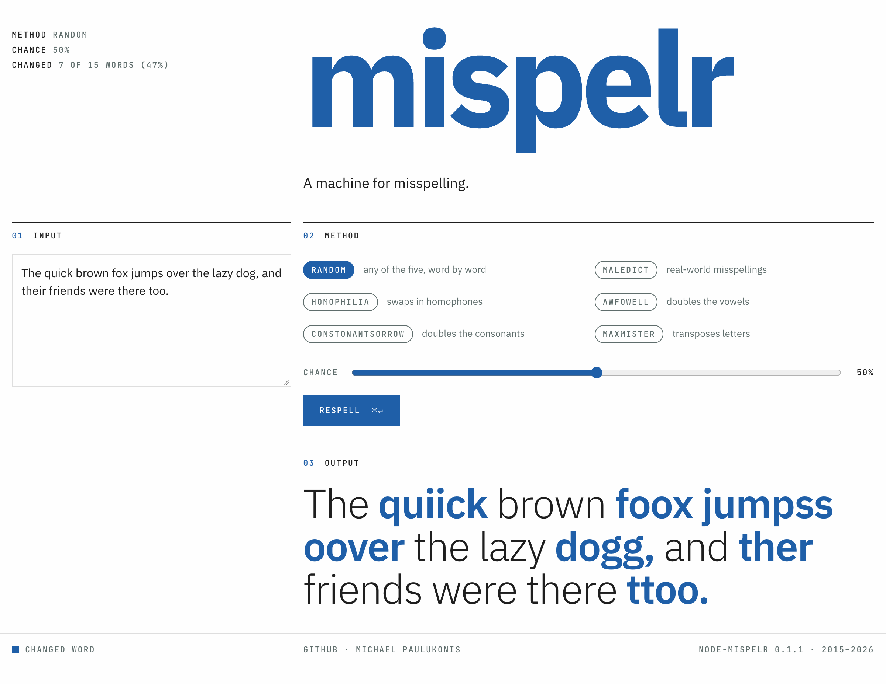

I had completely forgotten I wrote mispelr. It surfaced while I was working on [PoeticalBot](https://github.com/MichaelPaulukonis/textgen-monorepo/tree/main/apps/poeticalbot), which uses it to misspell poems, and there it was, a browser toy from 2015 that takes perfectly good text and ruins it.

[](https://michaelpaulukonis.github.io/mispelr/)

It has six ways to do the ruining:

- `maledict` swaps in real-world misspellings from a dictionary of common typos
- `awfowell` doubles (sometimes triples) vowels
- `constonantSorrow` does the same to consonants
- `maxmister` transposes two adjacent letters, never the first ("Teh qucik bronw fxo")
- `homophilia` swaps in homophones
- `random` mixes the others, word by word

It did what I wanted, but I was never completely happy with it. Every word went through the respeller once, and some came back unchanged, but how much of a sentence got mangled depended on the method and the dice and it was usually too much. There was no way to set it. And TBH, it was more annoying than anything else. Which was disappointing, since it did what I wanted. But eating a gallon of ice-cream in one go is not fun.

So I brought it back up to speed. It lives in [textgen-monorepo](https://github.com/MichaelPaulukonis/textgen-monorepo/tree/main/libs/mispelr) now, next to PoeticalBot. It's on npm as [node-mispelr](https://www.npmjs.com/package/node-mispelr). And the old Bootstrap page is a new [playground](https://michaelpaulukonis.github.io/mispelr/) (that's it up top).

Tuning it with percentages made a big difference. `respell` takes a `chance` option - the share of words to misspell, 0 to 1. It also takes an `rng`, so pass a seeded generator and the output is replayable: same seed, same text, same method, same misspelled poem. And each word's misspelling is fixed by the seed; `chance` only picks which ones get used. Raise it from 10% to 60% and the 10% typos are still there, with more added around them.

```js
const seedrandom = require('seedrandom')
const text =
  'The quick brown fox jumps over the lazy dog, and their friends were there too.'

mispelr.respell(text, 'random', { rng: seedrandom('fox'), chance: 0.1 })
mispelr.respell(text, 'random', { rng: seedrandom('fox'), chance: 0.6 })
// the second keeps every misspelling from the first, and adds more
```

`chance` isn't always exact. `maledict` and `homophilia` pass through any word they don't have an entry for, and `maxmister` skips anything under three letters, so the remaining words make up the difference as far as they can.

Extending the README also turned up a bug that had been sitting in the data for eleven years. A few rows in the homophone list were written as prose - `there,their,and they're`, `to,too,and two` - and the conversion script kept the "and". So `homophilia` turned "their" into "and they're". I'd seen it in the playground but not chased it. Generating examples from real seeded output put it right in front of me. Fixed in 0.1.1.

- Playground: <https://michaelpaulukonis.github.io/mispelr/>
- npm: [node-mispelr](https://www.npmjs.com/package/node-mispelr)
- Source: [textgen-monorepo/libs/mispelr](https://github.com/MichaelPaulukonis/textgen-monorepo/tree/main/libs/mispelr)
